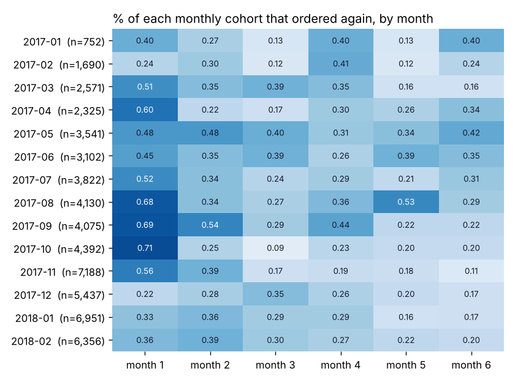
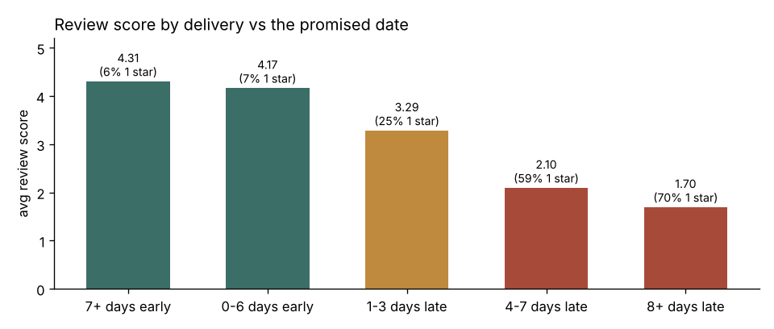
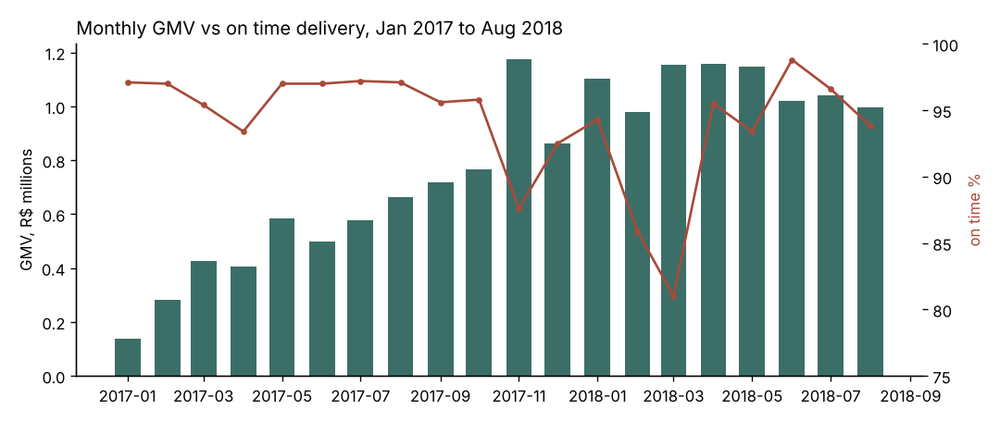

# Olist E-commerce: SQL Analysis in Postgres

About 100k orders from Olist, a Brazilian online marketplace (2016 to 2018), loaded into Postgres and analyzed with plain SQL. Revenue trends, cohort retention, repeat buying, delivery performance, and whether late deliveries cost repeat customers.

All the analysis is in `sql/`. There's a small Python script that makes charts from the results, but every number below comes straight out of a query.

## Questions I wanted to answer

1. How fast is the business growing, and is it more orders or bigger orders?
2. Do customers come back? (cohorts by first purchase month)
3. Is delivery on time, and does it matter?
4. Does a late first delivery make someone less likely to order again?
5. Where are the problem shipping lanes?

The delivery questions are the part I cared most about. At DHL I tracked on-time delivery every day, and the question that always came up was "ok, but what does a late shipment actually cost us?" This dataset has delivery dates AND review scores AND repeat purchases for the same orders, so you can actually check.

## Setup

```
docker compose up -d     # Postgres 16 on localhost:5432, or point at your own
./get_data.sh            # downloads the CSVs into data/
./run_all.sh             # builds tables, loads data, runs every query, saves results/
python charts.py         # optional, needs pandas + matplotlib
```

`run_all.sh` uses the normal `PGHOST / PGUSER / PGPASSWORD` env vars if you're not using the docker setup.

## Data model

8 source tables. I load them as is (`00_schema.sql`, `01_load.sql`) with primary keys, foreign keys and a few indexes, then build two views (`02_views.sql`) that everything else reads from:

* `v_orders`: one row per order with the real customer id, GMV, delivery days, a late flag, and the review score. Canceled and unavailable orders are filtered out here once so I don't have to remember it in every query.
* `v_items`: one row per item with the English category name and seller.

**Things that would have given wrong answers if I hadn't caught them:**

* **`customer_id` is not a customer.** Olist creates a new `customer_id` for every order. The actual person is `customer_unique_id`. My first cohort query used `customer_id` and showed exactly 0% retention, which is what tipped me off.
* **Same day "repeat" orders.** 869 of the 2,887 customers with 2+ orders placed them on the same day. That's someone checking out twice (split cart), not someone coming back. I count return visits by distinct order days.
* **`review_id` isn't unique** in the source, so the PK is `(review_id, order_id)`. A few orders have more than one review; the view keeps the latest.
* **Date range.** 2016 only has a few hundred orders and Sep/Oct 2018 is where the export cuts off, so trend queries use Jan 2017 to Aug 2018.
* Two categories were missing from the translation table, so I added them in the load script.

## What I found

**1. Growth is all volume. Basket size didn't move.**

| Jan to Aug | Orders | Customers | GMV (R$) | Avg order | Items/order |
|---|---|---|---|---|---|
| 2017 | 22,562 | 21,936 | 3.58M | 158.46 | 1.13 |
| 2018 | 53,530 | 52,336 | 8.60M | 160.58 | 1.14 |

GMV up 140%, average order value basically flat. Monthly GMV peaked in Nov 2017 (Black Friday, R$1.17M, +53% vs Oct) and has been flat around R$1.0 to 1.15M a month all of 2018. Freight is about 14% of GMV and creeping up. (`10_monthly_revenue.sql`, `11_ytd_comparison.sql`)

**2. Almost nobody comes back.**

Only 2.12% of customers ever placed a second order on a different day (3.04% if you count the same day split carts). Repeat customers bring in just 5.7% of GMV. For every monthly cohort, the share ordering again in any single later month is under 1%. Median time to a second order is 75 days.



So the growth above is being bought with new customer acquisition every month. That's the biggest business takeaway here. (`20_cohort_retention.sql`, `21_repeat_customers.sql`)

**3. Late deliveries wreck reviews.**

| Delivered vs promised date | Orders | Avg review | 1 star |
|---|---|---|---|
| 7+ days early | 75,744 | 4.31 | 6.5% |
| 0 to 6 days early | 13,699 | 4.17 | 7.3% |
| 1 to 3 days late | 1,852 | 3.29 | 25.1% |
| 4 to 7 days late | 1,748 | 2.10 | 58.6% |
| 8+ days late | 2,781 | 1.70 | 69.8% |

Even 1 to 3 days late drops the average almost a full star. Also worth noting: most orders show up way before the estimate (around 11 to 12 days early in a typical month), so the promised dates are heavily padded. That padding is probably why on time looks good most of the year.



**4. And a late first delivery means fewer customers come back.**

| First order | Customers | Ordered again | Rate |
|---|---|---|---|
| On time | 51,560 | 1,511 | 2.93% |
| Late | 3,667 | 73 | 1.99% |

About a third fewer late customers came back. Small numbers on both sides, so I ran a two proportion z-test inside the query: z = -3.29, so it's not just noise (p around 0.001). This only covers customers whose first order was Jan 2017 to Feb 2018, so everyone had at least 6 months to come back. (`32_late_first_order_vs_return.sql`)

**5. On time fell apart twice.**

Normally 93 to 98% on time. It dropped to 87.6% in Nov 2017 (Black Friday volume) and then to 85.9% in Feb and 81.0% in Mar 2018. The Black Friday dip has an obvious cause. The Feb/Mar 2018 one I can't explain from this data alone; volume wasn't unusual those months.



**6. Problem lanes are São Paulo to the Northeast, but the biggest one is SP to Rio.**

SP -> MA is late 19.7% of the time, SP -> PI 16.3%, SP -> CE 13.7%. But SP -> RJ is late 13.5% on 9,403 items, way more volume than any of those. If I were picking one lane to fix first it would be that one. (`33_worst_lanes.sql`)

**Also:** the top 10% of sellers do 67.5% of revenue (`40_seller_concentration.sql`), and 77% of orders are paid by credit card, with 9+ installment purchases averaging R$387 vs R$96 for paid in full (`41_payment_mix.sql`).

## SQL used

CTEs, window functions (`LAG`, rolling `AVG ... ROWS BETWEEN`, `NTILE`, `DENSE_RANK`, `ROW_NUMBER`, running `SUM`), `FILTER` clauses for pivoting the cohort table, `DISTINCT ON`, `percentile_cont`, date math with `age()` and `date_trunc`, views, and constraints/indexes on the base tables.

The cohort query is probably the one worth reading first:

```sql
WITH firsts AS (
    SELECT customer, min(order_month) AS cohort
    FROM v_orders
    GROUP BY customer
),
activity AS (
    SELECT DISTINCT f.cohort, v.customer,
           (extract(year FROM age(v.order_month, f.cohort)) * 12
            + extract(month FROM age(v.order_month, f.cohort)))::int AS month_n
    FROM v_orders v
    JOIN firsts f USING (customer)
)
SELECT cohort,
       round(100.0 * count(*) FILTER (WHERE month_n = 1) / count(*) FILTER (WHERE month_n = 0), 2) AS m1,
       ...
```

## If I kept going

* Join the geolocation table to get actual distance per lane, and see if late % is a distance thing or a carrier thing.
* Look at the review comment text for the late orders (it's in Portuguese, so translation first).
* Build a seller scorecard: late %, review score, cancel rate.

## Files

```
sql/
  00_schema.sql                     tables, keys, indexes
  01_load.sql                       \copy from CSV
  02_views.sql                      v_orders, v_items
  10_monthly_revenue.sql            MoM, rolling 3 month, YoY
  11_ytd_comparison.sql             Jan-Aug 2018 vs 2017
  12_category_growth.sql            top categories + growth
  20_cohort_retention.sql           monthly cohort table
  21_repeat_customers.sql           repeat rate, time to 2nd order
  30_delivery_performance.sql       on time % by month
  31_late_delivery_vs_reviews.sql   review score by lateness
  32_late_first_order_vs_return.sql late first order vs coming back + z-test
  33_worst_lanes.sql                seller state -> customer state
  40_seller_concentration.sql       revenue by seller decile
  41_payment_mix.sql                payment type and installments
results/                            CSV output of every query
charts/                             made by charts.py
```

Data: [Brazilian E-Commerce Public Dataset by Olist](https://www.kaggle.com/datasets/olistbr/brazilian-ecommerce), CC BY-NC-SA 4.0.
